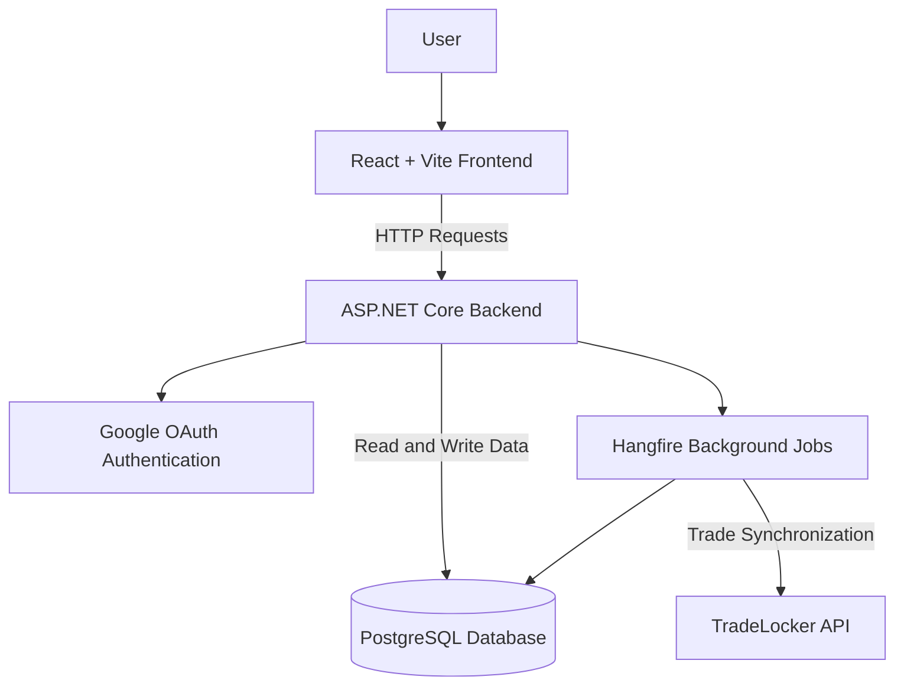

# TradeForge

### Trading Journal & Performance Analytics Platform

TradeForge is a trading journal platform designed to help traders record, organize, and analyze their trading performance. It combines trade journaling, performance analytics, and automated trade synchronization in one application.

The project focuses on providing traders with meaningful insights into their performance through interactive dashboards, statistical analysis, and organized trading records.

> **Project Status:** In Development
> **Repository:** Portfolio showcase only. The application source code is maintained privately.

---

## Project Overview

TradeForge aims to simplify the process of tracking trading activity and evaluating performance over time.

The platform includes features designed to help traders:

- Record and organize individual trades.
- Analyze performance through statistical dashboards.
- Monitor equity curves, win rates, profit and loss, and drawdown.
- Synchronize trading activity through external platform integrations.
- Maintain a structured trading journal with notes, screenshots, and tags.
- Manage trading records through a multi-user application.

The goal is to bring trade journaling and performance analysis together in a single, organized platform.

**Demo Video**

Add your demonstration video or its hosted link here.

*Note: The demonstration uses selected application views and does not expose the private source code.*

---

## Technology Stack

TradeForge is built using a modern full-stack architecture.

| Technology   | Purpose                                                 |
| ------------ | ------------------------------------------------------- |
| C#           | Backend development                                     |
| ASP.NET Core | Backend application and REST API                        |
| React        | Frontend user interface                                 |
| Vite         | Frontend development and build tooling                  |
| PostgreSQL   | Relational database                                     |
| Hangfire     | Background job processing and scheduled synchronization |
| Google OAuth | Authentication                                          |
| REST APIs    | Communication with external services                    |
| Git & GitHub | Version control and project management                  |

### Architecture Overview

The application separates the frontend, backend, database, and background processing responsibilities.

**Architecture components:**

- **Frontend:** Provides the user interface for journaling trades and viewing analytics.
- **Backend:** Handles application logic and API requests.
- **Database:** Stores application data.
- **Authentication:** Supports Google OAuth.
- **Background processing:** Uses Hangfire to execute trade synchronization jobs.
- **External integration:** Connects with the TradeLocker API to synchronize trading activity.

*This is a high-level representation of the application, not a complete infrastructure or deployment diagram.*

---

## Key Features

### Trading Analytics

Performance dashboards designed to help traders understand their results through metrics such as win rate, profit and loss, equity curves, and drawdown.

### Trade Journaling

Structured trading records with support for notes, screenshots, and tags, helping users review and organize their trading activity.

### Automated Trade Synchronization

Integration with the TradeLocker REST API, with background processing handled through Hangfire.

### Authentication & User Management

Google OAuth authentication and multi-user application support.

### Backend Reliability

REST API architecture with rate limiting and background job processing.

---

## Technical Challenges & Engineering Focus

Developing TradeForge has involved working with several aspects of full-stack application engineering.

### 1. External API Integration

Integrating an external trading platform API requires retrieving and processing trading data while accounting for the structure of the provider's responses.

TradeForge uses the TradeLocker REST API to support automated trade synchronization.

**Technologies:** C#, ASP.NET Core, REST APIs.

### 2. Background Processing

Trade synchronization requires work to happen outside ordinary user-facing requests.

Hangfire is used to run background jobs, separating synchronization tasks from the immediate frontend interaction.

**Technologies:** Hangfire, ASP.NET Core.

### 3. Financial Data Processing

Trading applications must process numerical data consistently to present useful performance statistics.

TradeForge includes analytics for profit and loss, win rate, equity curves, and drawdown, making accurate data handling an important part of the application.

**Engineering focus:** Data processing, calculations, and analytical reporting.

### 4. Authentication & Application Security

The application incorporates Google OAuth authentication and cookie-based session management.

Additional engineering considerations include rate limiting and the protection of sensitive configuration and user data.

**Technologies:** Google OAuth, ASP.NET Core, cookie-based sessions.

### 5. Full-Stack Integration

TradeForge brings together a React frontend, an ASP.NET Core backend, a PostgreSQL database, and background processing.

Maintaining clear responsibilities between these components is important for keeping the application maintainable as development continues.

**Technologies:** React, Vite, C#, ASP.NET Core, PostgreSQL, Hangfire.

---

## Development Approach

TradeForge is being developed as an evolving software product, with an emphasis on:

- Modular full-stack development.
- Separation of frontend and backend responsibilities.
- Integration with external APIs.
- Reliable processing of trading data.
- Application security and authentication.
- Practical analytics and user experience.
- Continuous testing and improvement.

The project provides practical experience in building and maintaining a full-stack application beyond isolated coding exercises.

---

## Project Availability

TradeForge is currently under active development.

The source code and private implementation are maintained in private repositories. This public repository serves as a portfolio presentation of the project, its architecture, technologies, and selected functionality.

The public showcase does not provide access to the application's proprietary source code, production credentials, or private configuration.

For professional inquiries, please contact me through my GitHub profile or professional contact details.

---

## Intellectual Property

© 2026 Denis Krosniqi. All rights reserved.

TradeForge is a proprietary project currently under development.

Unless explicitly authorized in writing, the project's name, branding, original assets, and proprietary materials may not be copied, redistributed, or used to create derivative products.

This repository is intended for portfolio and demonstration purposes. It does not grant permission to use or reproduce the private application source code.

---

## Author

**Denis Krosniqi**

Full-Stack Developer | Informatics & Communication Technology

**Technologies:** C#, ASP.NET Core, React, PostgreSQL, JavaScript.

GitHub: [github.com/denis21e](https://github.com/denis21e)
